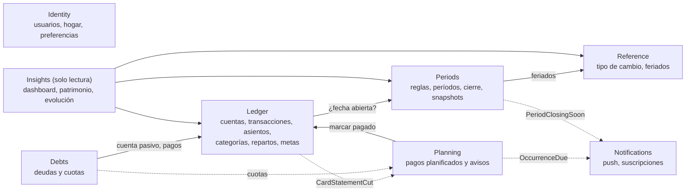
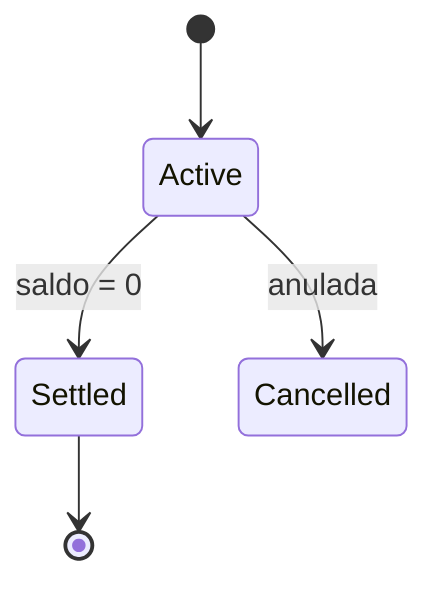
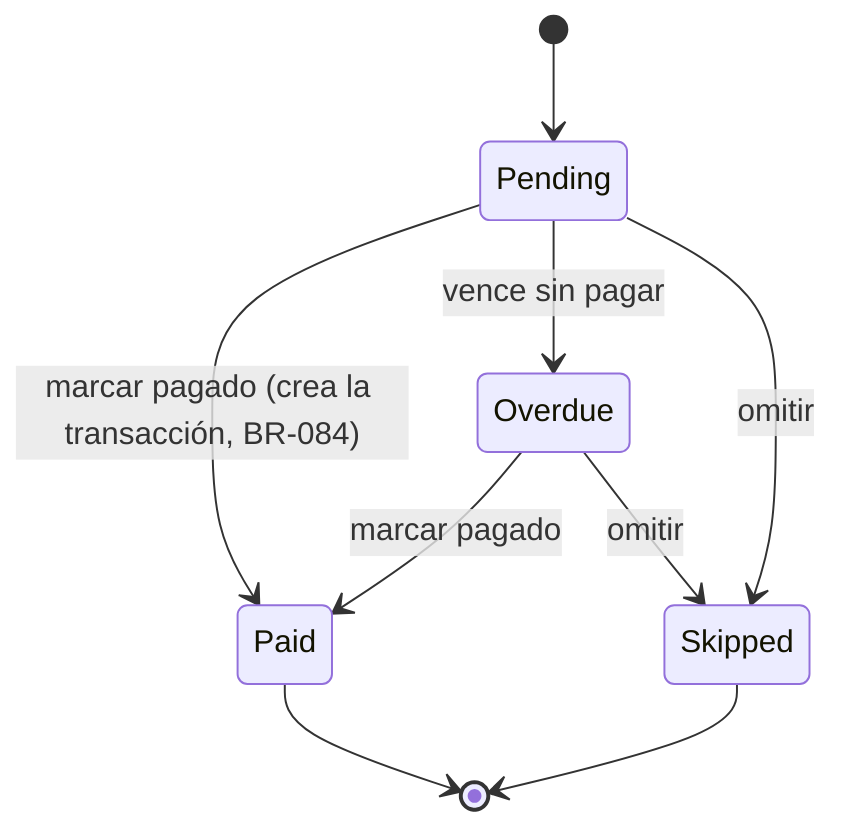
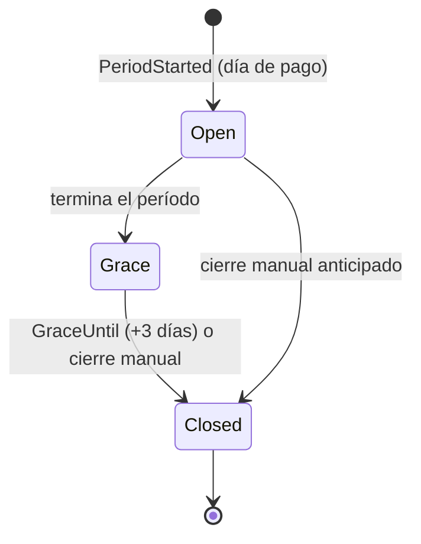
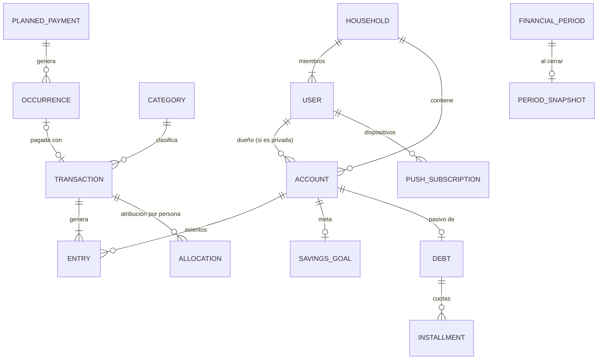

# Modelo de dominio — FinKey

Fuentes: `01-requirements.md` (historias US-xxx) y `01-business-rules.md` (reglas BR-xxx).
⚠️ = decisión cara de revertir → tendrá su ADR en la Fase 3.

---

## 1. Idea central: un libro contable (ledger) ⚠️

Toda operación financiera es una **Transacción** compuesta por **Asientos** (líneas). Cada asiento
mueve un monto con signo (+/−) en **una cuenta**. El saldo de una cuenta es la suma de sus asientos.

¿Por qué? Con un solo mecanismo se resuelven todos los casos, sin lógica especial por tipo:

| Operación | Asientos generados (ejemplo) | Efecto en el patrimonio |
|---|---|---|
| Gasto S/ 50 (efectivo) | Efectivo −50 | −50 |
| Ingreso salario S/ 3,000 | BCP +3,000 | +3,000 |
| Transferencia BCP → Interbank S/ 500 | BCP −500 · Interbank +500 | 0 |
| Transferencia PEN → USD | BCP −372.50 · Ahorro USD +100 (TC 3.725) | 0 |
| Gasto con tarjeta S/ 200 | Tarjeta −200 (aumenta la deuda) | −200 |
| Pago de tarjeta S/ 200 | BCP −200 · Tarjeta +200 | 0 (no hay gasto doble, BR-015) |
| Gasto compartido S/ 100 que pago yo | Mi BCP −100 · *Mi "Por cobrar a pareja"* +50 · *Su "Por pagar a pareja"* −50 | Yo −50, ella −50 (BR-032) |
| Préstamo a mi pareja S/ 200 | Mi BCP −200 · Mi *Por cobrar* +200 · Su BBVA +200 · Su *Por pagar* −200 | 0 para ambos |
| Pago de cuota de deuda S/ 300 (+ S/ 20 de interés) | BCP −320 · Préstamo +300 · (gasto interés 20) | −20 |

- Las **cuentas de pareja** ("Por cobrar a pareja" / "Por pagar a pareja") son **cuentas virtuales**
  del sistema: una por miembro y por moneda. **Saldo entre pareja = saldo de esas cuentas** (BR-051, BR-053),
  sin cálculos aparte, y el patrimonio individual las incluye automáticamente (BR-111).
- Las **deudas con terceros** y las **tarjetas** son cuentas de **pasivo**; el patrimonio es simplemente
  la suma de todas las cuentas convertida a PEN (BR-110).
- La **categoría** y la **atribución del gasto por persona** (para los reportes de cada uno, BR-032 y BR-114)
  viven en la transacción, no en los asientos.
- Aclaración de BR-020: el usuario siempre ingresa montos positivos; el **signo** es interno a los asientos.
- No es contabilidad de partida doble completa (las categorías no son cuentas): es un ledger simplificado,
  suficiente y auditable.

---

## 2. Eventos de dominio (Event Storming ligero)

| Módulo | Evento | Comando que lo provoca | Quién |
|---|---|---|---|
| Identity | `UserRegistered` | Registrarse | Usuario |
| Identity | `HouseholdCreated` | Crear hogar | Usuario |
| Identity | `MemberInvited` / `InvitationAccepted` | Invitar / Aceptar invitación | Usuario |
| Identity | `HouseholdTotalViewEnabled` | Activar el total del hogar (ambos) | Usuarios |
| Ledger | `AccountOpened` / `AccountShared` / `AccountArchived` | Abrir / compartir / archivar cuenta | Usuario |
| Ledger | `IncomeRecorded` / `ExpenseRecorded` | Registrar ingreso / gasto | Usuario |
| Ledger | `SharedExpenseRecorded` | Registrar gasto compartido | Usuario |
| Ledger | `TransferRecorded` | Registrar transferencia | Usuario |
| Ledger | `PartnerLoanRecorded` / `PartnerBalanceSettled` | Prestar / liquidar | Usuario |
| Ledger | `AdjustmentRecorded` | Ajustar un período cerrado | Usuario |
| Ledger | `CardStatementCut` | (corte de tarjeta) | Tiempo |
| Ledger | `GoalCreated` / `GoalReached` | Crear meta / (saldo ≥ objetivo) | Usuario / Sistema |
| Debts | `DebtRegistered` / `DebtPaymentRecorded` / `DebtSettled` | Registrar deuda / pagar cuota | Usuario / Sistema |
| Planning | `PaymentPlanned` | Planificar pago | Usuario / Sistema (corte de tarjeta, cuotas) |
| Planning | `OccurrenceDueSoon` / `OccurrenceDue` / `OccurrenceOverdue` | (fechas de aviso) | Tiempo |
| Planning | `OccurrencePaid` / `OccurrenceSkipped` | Marcar pagado / omitir | Usuario |
| Periods | `PeriodStarted` / `PeriodClosingSoon` / `PeriodClosed` | (regla de período) / Cerrar | Tiempo / Usuario |
| Reference | `ExchangeRateFetched` / `ExchangeRateOverridden` | (job diario) / Corregir TC | Tiempo / Usuario |
| Notifications | `NotificationSent` / `NotificationFailed` | (reacción a eventos) | Sistema |

---

## 3. Módulos (bounded contexts)

Flecha sólida = llamada a un contrato público del módulo · Flecha punteada = evento de dominio.

| Módulo | Responsabilidad | Agregados |
|---|---|---|
| **Identity** | Usuarios, hogar, membresía, invitaciones, preferencias (moneda base, zona horaria) | `User`, `Household`, `Invitation` |
| **Ledger** (núcleo) | Cuentas, transacciones y asientos, categorías, repartos de gastos compartidos, cuentas de pareja, ciclo de tarjeta, metas de ahorro | `Account`, `Transaction`, `Category`, `SavingsGoal` |
| **Debts** | Deudas con terceros: acreedor, cronograma de cuotas, estado | `Debt` |
| **Planning** | Pagos planificados (únicos/recurrentes), ocurrencias, política de avisos | `PlannedPayment` |
| **Periods** | Reglas de período, períodos financieros, cierre automático, snapshots | `PeriodRule`, `FinancialPeriod` |
| **Reference** | Tipo de cambio diario (auto + override), calendario de feriados | `ExchangeRate`, `Holiday` |
| **Notifications** | Suscripciones push por dispositivo, envío idempotente, historial | `PushSubscription`, `Notification` |
| **Insights** | Consultas: dashboard, patrimonio, evolución por período (sin escritura) | — (read models) |

Reglas entre módulos: ningún módulo lee las tablas de otro; esquema de BD por módulo.

---

## 4. Agregados, entidades y value objects

### Value Objects (compartidos)
| VO | Contenido | Reglas |
|---|---|---|
| `Money` | `Amount` (decimal) + `Currency` | Operaciones solo con la misma moneda; redondeo a 2 decimales (BR-021) |
| `Currency` | `PEN` \| `USD` (ISO 4217) | Extensible a otras monedas |
| `ExchangeRateValue` | moneda origen, destino, tasa (6 decimales) | Tasa > 0 |
| `Split` | lista de (miembro, monto) | Suma = total; el céntimo de redondeo va al pagador (BR-031) |
| `PeriodRuleKind` | `CalendarMonth` \| `FixedDay(n)` \| `LastBusinessDay` | n entre 1 y 31 (BR-086) |
| `Recurrence` | `Once` \| `Monthly(day)` \| `EveryNMonths(n, day)` \| `Yearly(month, day)` | Día inexistente → último día del mes (BR-081) |
| `ReminderPolicy` | días de aviso antes, el mismo día y vencido | Por defecto: 3, 0, +1 (BR-082) |
| `Ownership` | `HouseholdId` + `OwnerUserId?` (null = compartido) | Ver §6 |

### Ledger
**`Account`** (agregado)
- `Id`, `Ownership`, `Name`, `Institution?`, `Type`, `Currency`, `Status` (Active / Archived), `Nature` (Asset / Liability).
- `Type`: `Cash`, `BankAccount`, `Wallet`, `Savings`, `CreditCard`, `Loan`, `PartnerReceivable`*, `PartnerPayable`* (*virtuales, las crea el sistema).
- `CreditCardTerms?`: `CreditLimit`, `StatementDay`, `PaymentDay` (BR-013, BR-014).
- Invariantes: la moneda no cambia si ya tiene asientos (BR-010); solo se archiva con saldo 0 (BR-012); las cuentas virtuales no se editan ni se archivan a mano.
- El saldo **no se guarda como campo editable**: se calcula a partir de los asientos (con un caché/proyección por rendimiento).

**`Transaction`** (agregado)
- `Id`, `HouseholdId`, `Kind`, `Date` (fecha de calendario), `Description`, `CategoryId?`, `CreatedBy`, `Entries[]`, `Allocations[]`, `Fx?`, `AdjustsPeriodId?`, `Status` (Active / Voided).
- `Kind`: `Income`, `Expense`, `SharedExpense`, `Transfer`, `PartnerLoan`, `PartnerSettlement`, `CardPayment`, `DebtPayment`, `Opening`, `Adjustment`.
- `Entry`: `AccountId`, `Amount` con signo, en la moneda de la cuenta.
- `Allocation`: `UserId`, `Money`: la parte del gasto o ingreso atribuida a cada persona (reportes, BR-114).
- Invariantes:
  - Toda transacción tiene al menos 1 asiento; el monto ingresado es > 0 (BR-021).
  - `Transfer`, `CardPayment`, `PartnerLoan` y `PartnerSettlement` no cambian el patrimonio total del hogar: los asientos suman 0 por moneda, o se registra el TC implícito si las monedas difieren (BR-040, BR-041).
  - En `SharedExpense`, Σ allocations = total (BR-031).
  - `Opening` (saldo inicial) no cuenta como ingreso ni gasto en los indicadores.
  - Solo se crea, edita o anula si **todas** las cuentas afectadas están en un período abierto para su dueño (BR-090, **BR-098**).
- Editar = reemplazar asientos dentro de la misma transacción; borrar = `Voided` (borrado lógico). Ambos quedan auditados (BR-097).

**`Category`** — `Id`, `Ownership`, `Name`, `Kind` (Income / Expense), `Icon`, `IsSystem`, `Archived` (BR-022).

**`SavingsGoal`** — `Id`, `AccountId`, `TargetAmount` (moneda de la cuenta), `TargetDate?`, `Status` (Active / Reached / Cancelled).
Progreso = saldo de la cuenta / objetivo (BR-100 a BR-102).

### Debts
**`Debt`** (agregado) — `Id`, `Ownership`, `Creditor`, `LiabilityAccountId` (cuenta `Loan` en Ledger), `OriginalAmount`, `Installments[]?`, `Status`.
- `Installment`: `Number`, `DueDate`, `Amount`, `Status` (Pending / Paid).
- El saldo pendiente = saldo de la cuenta pasivo (BR-061). Pasa a `Settled` cuando llega a 0 (BR-062).
- Cada cuota genera una ocurrencia en Planning (BR-060).

### Planning
**`PlannedPayment`** (agregado) — `Id`, `Ownership`, `Title`, `EstimatedAmount` (Money), `AccountId?`, `CategoryId?`, `Recurrence`, `ReminderPolicy`, `Source` (Manual / CreditCard / DebtInstallment), `SourceRefId?`, `Occurrences[]`.
- `Occurrence`: `DueDate`, `Status`, `PaidTransactionId?`, `NotificationsSent[]`.

### Periods
**`PeriodRule`** — `Scope` (`User` \| `Household`) + `ScopeId`, `Kind`, `EffectiveFrom` (BR-086, BR-096).

**`FinancialPeriod`** (agregado) — `Id`, `Scope`, `ScopeId`, `Name` (mes en que termina, BR-089), `StartDate`, `EndDate`, `GraceUntil`, `Status`, `Snapshot?`.
- `Snapshot`: saldos por cuenta, TC de cierre, patrimonio, totales de ingresos y gastos (BR-093).

- Invariantes: cierre en orden (BR-095); como máximo 2 períodos no cerrados por scope (el anterior en gracia y el actual) (BR-092).

### Reference
- **`ExchangeRate`** — `Date`, `From`, `To`, `BuyRate`, `Source` (Auto / Manual). Manual > Auto (BR-120 a BR-122).
- **`Holiday`** — `Date`, `Name`, `Country` (PE). Se carga por año (BR-088).

### Identity
- **`User`** — `Id`, `Email`, `DisplayName`, `TimeZone` (America/Lima), `BaseCurrency` (PEN).
- **`Household`** — `Id`, `Name`, `Members[]` (máx. 2 en el MVP, BR-002), `HouseholdTotalConsent[]` (BR-115).
- **`Invitation`** — `Email`, `Token`, `ExpiresAt`, `Status` (Pending → Accepted / Expired / Revoked).

### Notifications
- **`PushSubscription`** — `UserId`, `Endpoint`, `Keys`, `Device`, `CreatedAt`, `LastSuccessAt`. Se elimina si el navegador responde 410 Gone.
- **`Notification`** — `UserId`, `Type`, `Payload`, `IdempotencyKey` (ej. `occurrence:{id}:due-3d`), `Status`, `SentAt`. La clave única evita duplicados (BR-085).

---

## 5. Diagrama de datos (simplificado)

---

## 6. Decisiones de datos ⚠️ (caras de revertir)

| Tema | Decisión | Motivo |
|---|---|---|
| **Ledger** | Transacción + asientos; saldo = Σ asientos | Un mecanismo para todos los casos; auditable; patrimonio y saldo entre pareja salen solos |
| **Dinero** | `numeric(18,2)` para montos, `numeric(12,6)` para tipos de cambio, `char(3)` para la moneda; VO `Money`; nunca `float` | Precisión exacta |
| **Fechas** | Fecha de la transacción, vencimientos y períodos como `date` (calendario America/Lima); timestamps técnicos como `timestamptz` en UTC; zona horaria guardada por usuario | Evita errores de "cambio de día" por UTC |
| **IDs** | UUID v7 en todas las entidades | Ordenables (buen rendimiento de índices), no exponen conteos, generables en el cliente |
| **Ownership / multi-tenant** | Toda fila de negocio lleva `household_id` (obligatorio) + `owner_user_id` (null = compartido) | Prepara el "diseño abierto" para más hogares; la privacidad se filtra en un solo lugar |
| **Autorización** | Filtro global por hogar + dueño (EF Core global query filters) y validación por recurso; *Row Level Security* de Postgres como defensa extra (evaluar en la Fase 6) | NFR-01 |
| **Borrado** | Transacciones: borrado lógico (`Voided`); cuentas y categorías: archivar; nunca borrado físico de datos financieros (salvo que el usuario pida borrar su cuenta) | Historial y cierres consistentes |
| **Auditoría** | Tabla `audit_log` (entidad, id, acción, usuario, fecha, antes/después en `jsonb`) vía interceptor | BR-097 |
| **Concurrencia** | Optimista: columna de versión (`xmin` en Postgres) → 409 Conflict si dos editan lo mismo | Ustedes dos pueden editar lo compartido a la vez |
| **Saldos** | Calculados desde los asientos; proyección cacheada por cuenta (actualizada en la misma transacción) | Exactitud + rendimiento |

---

## 7. Reglas nuevas descubiertas al modelar
(agregadas a `01-business-rules.md`)

- **BR-098**: Una transacción que afecta cuentas de distintos dueños (ej. un gasto compartido que toca la cuenta virtual de la pareja) solo se permite si la fecha está en un período abierto **para todos los dueños afectados**. Si la pareja ya cerró ese período, hay que usar una fecha de un período abierto o registrar un ajuste.
- **BR-099**: Las cuentas virtuales de pareja (`PartnerReceivable` / `PartnerPayable`) se crean automáticamente al unirse al hogar, una por miembro y por moneda usada.
- **BR-025**: Las transacciones `Opening` (saldo inicial) no cuentan como ingreso ni gasto en los indicadores.

---

## 8. Preguntas abiertas para la Fase 3
- Validar el ledger simplificado en un ADR (alternativa descartada: tablas separadas por tipo de operación).
- ¿RLS de Postgres desde el inicio o solo filtros en la aplicación? (recomendación preliminar: filtros en la app + tests de autorización; RLS como mejora).
