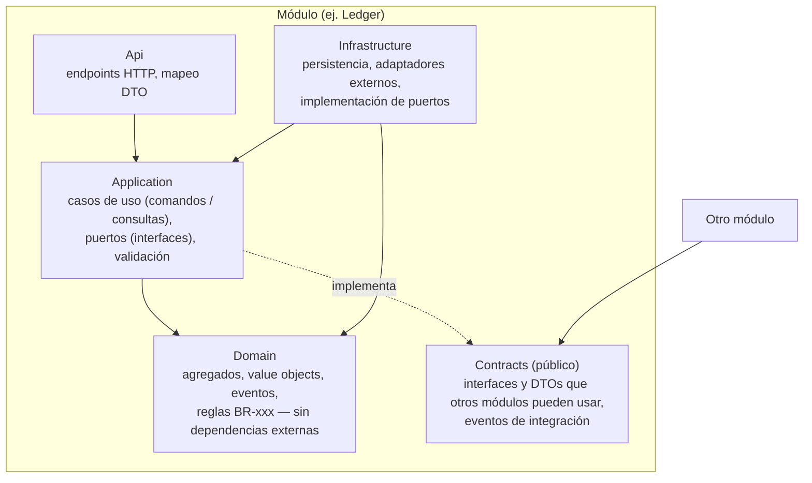
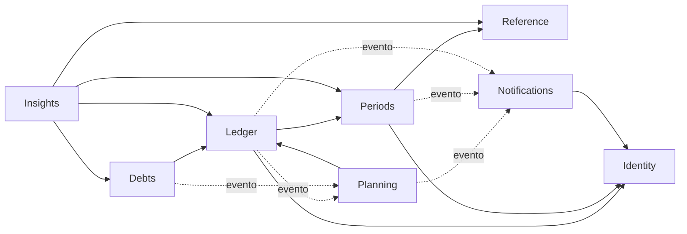
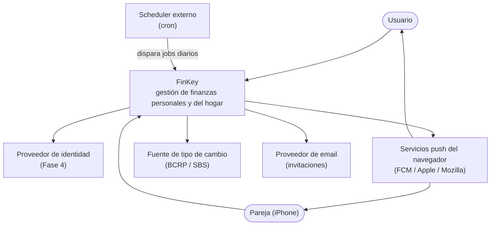
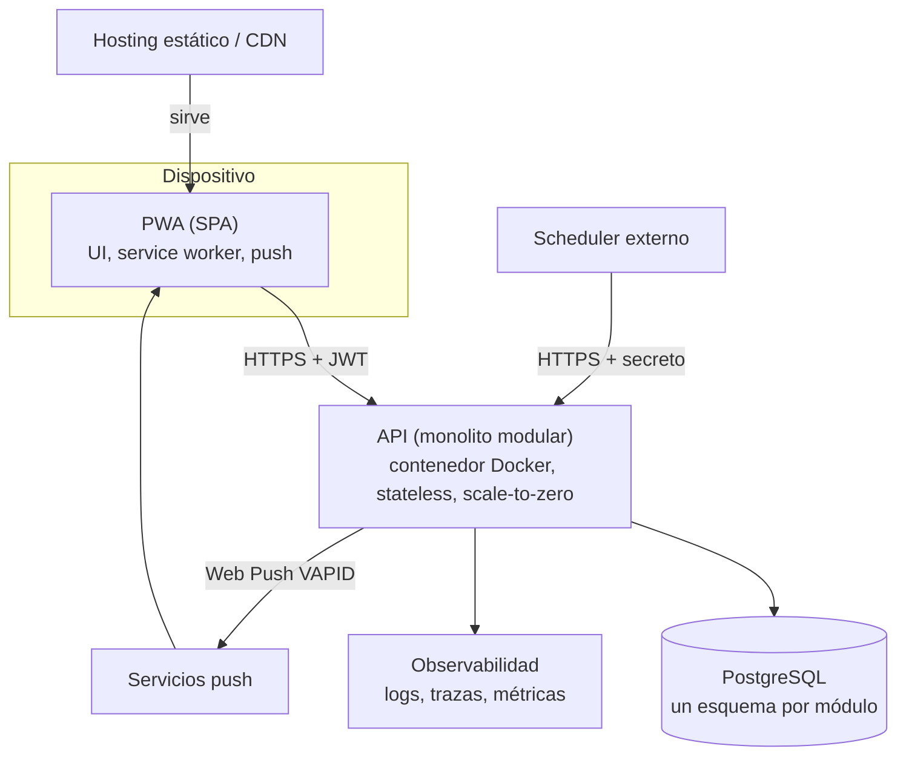
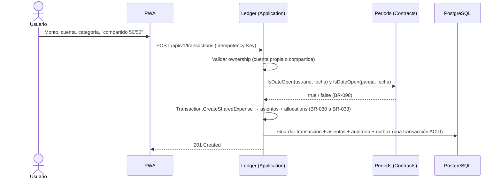
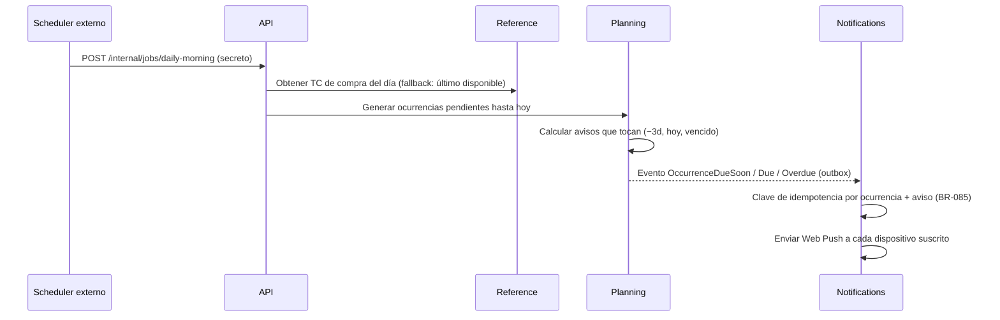
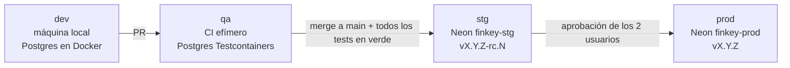

# Arquitectura — FinKey

Fuentes: `00-vision.md`, `01-requirements.md`, `01-business-rules.md`, `02-domain.md`.
Decisiones formales: `docs/adr/`. La tecnología concreta (lenguaje, frameworks, proveedor) se decide en la Fase 4 y el hosting en la Fase 7: este documento es **agnóstico del stack** salvo donde se indica.

---

## 1. Drivers de arquitectura

| Driver | Origen | Qué exige |
|---|---|---|
| **Seguridad y privacidad** ★ | NFR-01, BR-003/004/112/115 | Autorización por recurso centralizada; lo privado nunca se filtra entre miembros |
| **Usabilidad móvil** ★ | NFR-02, NFR-05 | PWA rápida, push confiables, API con respuestas pequeñas |
| **Mantenibilidad** ★ | NFR-03 | Módulos con fronteras claras, dependencias que apuntan al dominio, verificadas por tests |
| Costo $0 | Restricción | Un solo despliegue, una sola BD; la API se apaga sola (*scale-to-zero*) |
| Scale-to-zero | Visión | Nada puede depender de procesos en memoria que corran "siempre": los jobs se disparan desde afuera |
| Integridad de datos | NFR-06 | Transacciones ACID; ledger auditable |
| Equipo de 1 + IA | Restricción | Simplicidad operativa; convenciones estrictas para que la IA genere código consistente |

---

## 2. Estilo: monolito modular (ADR-0001)

Un **único despliegue** (una API + una PWA) dividido internamente en **8 módulos** independientes
(`02-domain.md` §3). Cada módulo es dueño de sus datos (esquema propio en la BD) y expone solo un **contrato público**.

Por qué no microservicios: 1 dev, $0, dominio aún en descubrimiento → serían costo sin beneficio.
Las fronteras se diseñan para que extraer un módulo a servicio más adelante sea mecánico.

---

## 3. Estructura de un módulo (ADR-0002)

Cada módulo de dominio sigue **Clean Architecture** (hexagonal). Las dependencias **solo apuntan hacia adentro**:



| Capa | Puede depender de | Nunca depende de |
|---|---|---|
| **Domain** | SharedKernel | Frameworks, BD, HTTP, otros módulos |
| **Application** | Domain, SharedKernel, **Contracts de otros módulos** | Infrastructure, Api, internals de otros módulos |
| **Infrastructure** | Application, Domain | Api, otros módulos (salvo sus Contracts) |
| **Api** | Application | Infrastructure (solo vía composición en el Host) |
| **Contracts** | SharedKernel (tipos primitivos) | Domain, Application, Infrastructure |

Variantes por módulo (no todo necesita la misma ceremonia):

| Módulo | Patrón | Motivo |
|---|---|---|
| Ledger, Periods, Planning, Debts | Clean completo + DDD táctico | Reglas ricas e invariantes |
| Identity | Clean ligero | Mayormente delega en el proveedor de identidad (Fase 4) |
| Reference, Notifications | Capas simples (Application + Infrastructure) | Poca lógica de dominio; mucha integración externa |
| Insights | **Vertical slices de solo lectura** (consulta SQL → DTO) | Reportes y gráficos; sin agregados (CQRS ligero) |

**CQRS ligero**: los comandos pasan por agregados (ORM); las consultas de lectura pesada (dashboard, patrimonio, evolución) van con SQL directo sobre vistas o proyecciones. Una sola BD.

### Bloques compartidos
- **SharedKernel**: `Money`, `Currency`, `Ownership`, IDs tipados, `Result`/errores, interfaz de eventos de dominio. Mínimo y estable: nada de lógica de negocio de un módulo.
- **BuildingBlocks** (infraestructura transversal): unit of work, outbox, auditoría, filtros de ownership, reloj inyectable, idempotencia, logging/tracing, manejo de errores (ProblemDetails).
- **Host**: punto de entrada; compone los módulos, configura auth, middleware, OpenAPI. No contiene lógica de negocio.

### Estructura de la solución (lógica; los nombres concretos se fijan en la Fase 4)
```
src/
├── backend/
│   ├── Host/                       # composición, middleware, configuración
│   ├── SharedKernel/
│   ├── BuildingBlocks/
│   └── Modules/
│       ├── Ledger/
│       │   ├── Ledger.Domain/
│       │   ├── Ledger.Application/
│       │   ├── Ledger.Infrastructure/
│       │   ├── Ledger.Api/
│       │   └── Ledger.Contracts/
│       ├── Periods/ … Planning/ … Debts/ … Identity/
│       ├── Reference/  Notifications/   # capas simples
│       └── Insights/                    # vertical slices de lectura
├── frontend/                       # PWA (ver §7)
tests/
├── Modules/<Módulo>.UnitTests/     # dominio y reglas BR-xxx
├── IntegrationTests/               # API + BD real en contenedor
├── ArchitectureTests/              # verifica las reglas de dependencia
└── e2e/                            # flujos críticos
```

---

## 4. Comunicación entre módulos (ADR-0006)

| Necesidad | Mecanismo | Ejemplo |
|---|---|---|
| Consulta síncrona | Interfaz en `Contracts` del módulo dueño | Ledger pregunta a Periods `IsDateOpen(scope, date)` (BR-090, BR-098) |
| Comando que el usuario espera ver aplicado de inmediato | Interfaz en `Contracts`, **misma transacción de BD** | Planning "marcar pagado" → `Ledger.RecordTransaction` → guarda `PaidTransactionId` |
| Reacción que puede ocurrir después | **Evento de integración** vía **Outbox** (se guarda en la misma transacción y se despacha después) | `CardStatementCut` (Ledger) → Planning crea la ocurrencia de pago |

Reglas:
- Un módulo **nunca** accede a las tablas ni a las clases internas de otro.
- Los eventos de integración viven en `Contracts` y son **versionables** (solo se agregan campos).
- Los consumidores de eventos son **idempotentes** (registro de eventos procesados).
- Prohibidas las dependencias circulares entre módulos (verificado por tests de arquitectura).

Mapa de dependencias permitidas (`→` = usa el contrato de):



---

## 5. Diagramas C4

### Nivel 1 — Contexto


### Nivel 2 — Contenedores


Nivel 3 (componentes) = los módulos de §3 y §4.

---

## 6. Jobs con la API apagada (ADR-0007)

Con *scale-to-zero* no hay procesos en memoria corriendo siempre, así que **no usamos schedulers internos**.
Un **scheduler externo** llama a endpoints internos protegidos, que son **idempotentes** (ejecutarlos 2 veces no duplica nada):

| Job | Cuándo | Qué hace | Reglas |
|---|---|---|---|
| `daily-morning` | 08:00 America/Lima | Tipo de cambio del día → generar ocurrencias → enviar avisos (antes / hoy / vencido) | BR-082 a BR-085, BR-120 a BR-122 |
| `daily-midnight` | 00:05 America/Lima | Abrir y cerrar períodos (gracia vencida), cortes de tarjeta, aviso "el período cierra mañana" | BR-014, BR-087, BR-091 |
| `outbox-dispatch` | Al final de cada request y en cada job | Despachar eventos pendientes | ADR-0006 |

- Cada job registra su ejecución (inicio, fin, resultado) para observabilidad y reintentos.
- Si un job falla, la siguiente ejecución recupera lo pendiente: se procesa "todo lo que debió ocurrir hasta hoy", no solo "hoy".
- El endpoint exige un secreto o token de servicio; nunca es público.

---

## 7. Frontend (PWA)

Organización por **features alineadas a los módulos**, con la misma regla de dependencias hacia adentro:

```
frontend/src/app/
├── core/          # auth, interceptores HTTP, manejo de errores, layout, service worker / push
├── shared/        # componentes de UI puros (design system), pipes (moneda, fecha), utilidades
├── api/           # cliente generado desde el OpenAPI (nunca DTOs escritos a mano)
└── features/
    ├── accounts/  transactions/  partner/  debts/
    ├── planning/  savings/  periods/  insights/  settings/
```
- **Componentes de presentación** (sin estado, solo inputs/outputs) separados de los **contenedores** (orquestan estado y llamadas).
- Estado por feature con signals; nada de un store global gigante.
- Una feature no importa internals de otra; lo compartido va a `shared/` o `core/`.
- Design tokens exportados desde Penpot → variables CSS → componentes de `shared/` → Storybook.
- Registro rápido de gasto (NFR-02): formulario mínimo, montos con teclado numérico, últimas categorías primero.

---

## 8. Aspectos transversales

| Aspecto | Decisión |
|---|---|
| Autenticación | OIDC/JWT; proveedor a elegir en la Fase 4 |
| Autorización | `Ownership` en cada agregado + filtro global por hogar y dueño + validación por recurso en cada caso de uso; un recurso ajeno devuelve **404** (no 403, para no revelar que existe) (ADR-0004) |
| Validación | En Application (entrada) y en Domain (invariantes); errores con código `BR-xxx` |
| Errores HTTP | ProblemDetails (RFC 9457), con código de regla de negocio cuando aplica |
| Tiempo | Reloj inyectable; "hoy" se calcula en la zona del usuario o del hogar |
| Idempotencia | Header `Idempotency-Key` en los comandos de creación (evita duplicados por reintentos desde el móvil) |
| Auditoría | Interceptor de persistencia → `audit_log` (BR-097) |
| Observabilidad | Logs estructurados con correlation id, trazas distribuidas, métricas de jobs y push (detalle en la Fase 7) |
| Configuración | Variables de entorno (12-factor); secretos fuera del repo |
| API | REST versionada (`/api/v1`), OpenAPI generado desde el código, documentación interactiva |

---

## 9. Flujos críticos

### Registrar un gasto compartido


### Job diario de avisos


---

## 10. Escalabilidad

Principio: **diseñar para 10x, documentar 100x, no construir para 1000x.** FinKey es para un hogar; el modelo admite más hogares (BR-001), pero no se optimiza para eso.

### 10.1 Estimación de capacidad
Supuestos: unos 10 movimientos por persona al día. Cada movimiento genera aproximadamente 1 transacción, 2–3 asientos y 1–2 asignaciones, es decir, unas 5 filas.

| Métrica | Hoy (1 hogar, 2 usuarios) | 10x (10 hogares) | 100x (100 hogares) |
|---|---|---|---|
| Usuarios concurrentes | 1–2 | ~5 | ~20 |
| Escrituras/día | ~20 movimientos (~100 filas) | ~200 (~1 000 filas) | ~2 000 (~10 000 filas) |
| Lecturas/día (requests) | ~300–500 | ~5 000 | ~50 000 (≈ 0,6 req/s promedio) |
| Filas del ledger a 3 años | ~110 000 | ~1,1 M | ~11 M |
| Tamaño de BD a 3 años (con índices) | ~50 MB | ~400 MB | ~4 GB |
| Suscripciones push | 2–6 | ~50 | ~500 |
| Archivos | 0 (sin adjuntos en el MVP) | — | — |

**Conclusiones**
- **Hoy y con 10x**, todo entra en una instancia de API con *scale-to-zero* y en el free tier de Neon (0,5 GB por proyecto). La carga es despreciable.
- **El primer límite real es el almacenamiento**, no la CPU. Con 10x, a unos 3 años, nos acercamos a los 0,5 GB de Neon. Para 2 usuarios, eso ocurre recién en décadas.
- **El problema que sí tenemos hoy es el arranque en frío.** La primera petición después de un rato inactivo despierta la API y Neon, y puede tardar unos 2–5 s. Se mitiga en el diseño (§10.3); no es un problema de escala.

### 10.2 Decisiones tomadas desde el día 1 (baratas ahora, caras después)
| Decisión | Por qué | Dónde |
|---|---|---|
| **API sin estado** | Permite *scale-to-zero* y varias instancias sin cambios | Todo el backend |
| **Llaves de Data Protection persistidas en Postgres** (`PersistKeysToDbContext`) | Sin esto, las cookies de sesión se invalidan cada vez que la instancia se apaga y se reinicia | Identity / Shared.Infrastructure |
| **Jobs idempotentes con lock** (`pg_try_advisory_lock` por job) | El scheduler puede reintentar y dos instancias podrían ejecutarlo a la vez | §6, ADR-0007 |
| **Outbox procesado al final del request + barrido en los jobs** | Con *scale-to-zero* no se puede depender de un `BackgroundService` siempre vivo | ADR-0006 |
| **Paginación por cursor (keyset)** en todos los listados, con `occurred_on` + `id` (UUID v7, ordenable) | Rendimiento constante aunque crezca el histórico | Ledger, Debts, Insights |
| **Índices desde la primera migración**: `(household_id, occurred_on)`, `(account_id, occurred_on)`, `(owner_user_id)` y `(status, due_on)` para ocurrencias planificadas | Las consultas siempre filtran por hogar y fecha | Migraciones por módulo |
| **Resúmenes por período cerrado** (`period_summary`: saldo, ingresos y gastos por cuenta/categoría y por usuario) generados al cerrar | Los períodos cerrados son inmutables (BR-086+), así que se calculan una vez. Insights lee los resúmenes y solo calcula en vivo el período abierto | Periods → evento `PeriodClosed` → Insights |
| **`Idempotency-Key` en los comandos de registro** | Evita duplicados por doble tap o por reintentos con mala señal móvil | Ledger, Debts |
| **Configuración por variables de entorno** (12-factor) | La misma imagen en stg y prod (ADR-0009) | Todo |
| **Esquema por módulo y comunicación por contratos/eventos** | Permite extraer un módulo sin reescribir | ADR-0001, ADR-0006 |

### 10.3 Arranque en frío (prioridad hoy)
- **PWA:** el *app shell* se carga desde el service worker al instante, y muestra skeletons y los últimos datos cacheados mientras la API despierta.
- **Backend:**
  - publicación con **ReadyToRun** e imagen *chiseled* de .NET, para reducir el tiempo de arranque;
  - inicialización perezosa de lo que no se necesita al arrancar;
  - sin migraciones en el arranque: se aplican en el pipeline.
- **Neon:** la reactivación tarda menos de 1 s. Se usa su connection pooler con `Npgsql`, con un pool pequeño.
- **Native AOT:** queda descartado por ahora. EF Core y Identity no lo soportan por completo, y el ahorro no justifica las restricciones.
- **Instancias mínimas mayores a 0:** solo si algún día se paga el hosting. Va contra el requisito de $0.

### 10.4 Escalera de escalado de FinKey
Se sube un peldaño solo cuando una métrica lo pide. Las métricas salen de OpenTelemetry y `pg_stat_statements`.

| # | Señal | Acción |
|---|---|---|
| 1 | Endpoint con p95 > 500 ms (sin contar el arranque en frío) | Revisar la consulta: índices, N+1, proyecciones, `AsNoTracking` |
| 2 | Dashboards lentos por la cantidad de histórico | Ya mitigado con `period_summary`; si no basta, una vista materializada por mes |
| 3 | CPU o memoria de la instancia > 70 % sostenido | Subir CPU/RAM de la instancia |
| 4 | Más de 1 instancia necesaria | Ya es posible gracias a la API sin estado y los locks de los jobs |
| 5 | Lecturas repetidas de datos de referencia (TC, feriados, categorías) | `ETag` / `Cache-Control` y output cache en memoria por instancia. Redis solo con varias instancias y medición |
| 6 | BD > 0,5 GB | Plan pago de Neon o archivado de períodos antiguos (los resúmenes se conservan) |
| 7 | Tabla de asientos > 50 M filas | Particionar por fecha (`occurred_on`) |
| 8 | Notificaciones o Insights con carga muy distinta al resto | Extraerlos a un servicio propio: ya se comunican por eventos y contratos |

### 10.5 Qué cambiaría con 100x (documentado, no construido)
- Plan pago de base de datos y probablemente una instancia mínima siempre encendida, para quitar el arranque en frío.
- Envío de push en lotes desde una cola, si hay picos (por ejemplo, todos los recordatorios a las 08:00).
- RLS en Postgres como segunda barrera de aislamiento entre hogares (se evalúa en la Fase 6).
- Email transaccional obligatorio: verificación y recuperación de cuenta para desconocidos.
- Observabilidad con alertas activas, no solo dashboards.

### 10.6 Reversibilidad en FinKey
| Cara de revertir ⚠️ (con ADR) | Barata de revertir |
|---|---|
| Ledger y ownership (`household_id` + `owner_user_id`) — ADR-0003/0004 | Librería de gráficos, componentes de UI |
| Dinero `numeric(18,2)` + moneda, fechas `date` en Lima, UUID v7 — ADR-0005 | Mapperly, FluentAssertions, handlers propios |
| Identity propio con passkeys — ADR-0012 | Proveedor de email, fuente secundaria de feriados |
| Monolito modular con esquema por módulo — ADR-0001 | Hosting de API y PWA (todo va en Docker) |
| .NET 10 como backend — ADR-0010 | Scheduler externo (solo llama endpoints) |

---

## 11. Ambientes, testing y versionado (ADR-0009)

### Ambientes


| Ambiente | BD | Datos | Credenciales | Se despliega |
|---|---|---|---|---|
| dev | Postgres local (`docker compose`) | Semilla de desarrollo | Locales | Manual |
| qa | Postgres efímero (Testcontainers) | Creados por cada test | Efímeras | En cada PR / push |
| stg | Proyecto Neon `finkey-stg` | Solo los que ambos usuarios ingresan a mano (sin seed ni copia de prod; solo datos de referencia del sistema) | Propias de stg | Automático al hacer merge a `main` |
| prod | Proyecto Neon `finkey-prod` | Reales | Propias de prod, mínimo privilegio | Al crear el tag `vX.Y.Z`, con aprobación manual |

- Ningún ambiente comparte BD, credenciales ni secretos con otro.
- La misma imagen Docker pasa de stg a prod (se construye una vez y se promueve); solo cambia la configuración.
- Las migraciones se aplican en stg y, al aprobar, en prod; antes de cada paso a prod se crea un punto de restauración.

### Capas de testing
| Capa | Qué prueba | Dónde corre | Bloquea el merge |
|---|---|---|---|
| **Unitarios** | Dominio y reglas BR-xxx (1+ test por regla), casos de uso con dobles de los puertos | dev + qa | Sí |
| **Arquitectura** | Reglas de dependencia entre capas y módulos (§3, §4) | dev + qa | Sí |
| **Integración** | Endpoints + persistencia + autorización (ADR-0004) contra Postgres real; migraciones desde cero | dev + qa | Sí |
| **Contrato de API** | El OpenAPI generado no cambia sin intención (snapshot); el cliente de la PWA se regenera | qa | Sí |
| **Componentes UI** | Componentes de la PWA con lógica | dev + qa | Sí |
| **E2E (Playwright)** | Flujos críticos completos en navegador (móvil y escritorio): login, registrar gasto compartido, transferir, planificar pago, cerrar período | qa (API + PWA + BD efímera); smoke E2E en stg tras el deploy | Sí (qa) |
| **Aceptación manual** | Ambos usuarios prueban la versión candidata | stg | Aprueba el paso a prod |

### Versionado
- **SemVer** a partir de **Conventional Commits**: `fix:` → PATCH, `feat:` → MINOR, `BREAKING CHANGE:` → MAJOR.
- Al hacer merge a `main` → versión candidata `vX.Y.Z-rc.N` en stg.
- Al aprobar → tag `vX.Y.Z`, release notes automáticas y deploy a prod.
- Las versiones se reflejan en Jira (Releases) y la API expone su versión en `/health`.
- El pipeline concreto está en [`06-devops.md`](06-devops.md) §5 (release-please, ADR-0019).

---

## 12. Índice de ADRs
| ADR | Decisión | Estado |
|---|---|---|
| [0001](adr/0001-monolito-modular.md) | Monolito modular | Aceptado |
| [0002](adr/0002-clean-architecture-por-modulo.md) | Clean Architecture por módulo + vertical slices de lectura | Aceptado |
| [0003](adr/0003-ledger-simplificado.md) | Ledger simplificado (transacción + asientos) | Aceptado |
| [0004](adr/0004-ownership-y-autorizacion.md) | Ownership por hogar/dueño y autorización | Aceptado |
| [0005](adr/0005-dinero-fechas-ids.md) | Representación de dinero, fechas e IDs | Aceptado |
| [0006](adr/0006-comunicacion-entre-modulos.md) | Comunicación entre módulos: contratos + eventos con outbox | Aceptado |
| [0007](adr/0007-jobs-disparados-externamente.md) | Jobs disparados por un scheduler externo | Aceptado |
| [0008](adr/0008-herramientas-de-diseno.md) | Herramientas de diseño: Penpot + Storybook | Aceptado |
| [0009](adr/0009-ambientes-y-bases-aisladas.md) | Ambientes dev/qa/stg/prod con bases de datos aisladas y versionado SemVer | Aceptado |
| [0010](adr/0010-backend-dotnet-10.md) | Backend en .NET 10 | Aceptado |
| [0011](adr/0011-postgresql-ef-core-dapper.md) | PostgreSQL + EF Core (comandos) + Dapper (lecturas) | Aceptado |
| [0012](adr/0012-autenticacion-aspnet-identity.md) | Autenticación con ASP.NET Core Identity (passkeys + contraseña) | Aceptado |
| [0013](adr/0013-frontend-angular-cdk-tailwind.md) | Frontend Angular 22 + CDK + Tailwind + componentes propios | Aceptado |
| [0014](adr/0014-fuente-tipo-de-cambio-bcrp.md) | Tipo de cambio: API del BCRP, serie SBS compra | Aceptado |
| [0015](adr/0015-sesion-cookie-con-proxy.md) | Sesión con cookie same-origin mediante proxy `/api` | Aceptado |
| [0016](adr/0016-rls-por-hogar.md) | Row-Level Security en Postgres por hogar | Aceptado |
| [0017](adr/0017-hosting-cloud-run-cloudflare-neon.md) | Hosting: Cloud Run + Cloudflare Pages + Neon, con Cloud Scheduler | Aceptado |
| [0018](adr/0018-backups-cifrados-en-r2.md) | Backups diarios cifrados con age en Cloudflare R2 | Aceptado |
| [0019](adr/0019-releases-con-release-please.md) | Versionado y releases con release-please | Aceptado |
| [0020](adr/0020-observabilidad-grafana-cloud.md) | Observabilidad con OpenTelemetry y Grafana Cloud | Aceptado |
