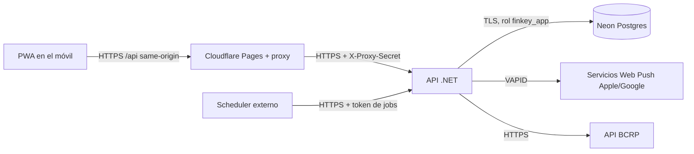

# FinKey — Calidad y seguridad (Fase 6)

Drivers: **NFR-01 Seguridad y privacidad ★**, **NFR-03 Mantenibilidad ★**, **NFR-02 Usabilidad móvil ★** y NFR-06 Integridad de datos.

Decisiones de esta fase:

| Tema | Decisión | ADR |
|---|---|---|
| Sesión | Cookie httpOnly `__Host-` same-origin, con proxy `/api` en Cloudflare | [ADR-0015](adr/0015-sesion-cookie-con-proxy.md) |
| Aislamiento de datos | Filtros en la aplicación (hogar + dueño) **y** RLS en Postgres por hogar | [ADR-0016](adr/0016-rls-por-hogar.md) |
| Autenticación | Passkey principal; con contraseña se exige TOTP; códigos de recuperación | [ADR-0012](adr/0012-autenticacion-aspnet-identity.md) (actualizado) |
| Repositorio | **Público** en GitHub: SonarCloud, CodeQL, secret scanning y Actions gratis | — |

---

## 1. Estrategia de testing

### 1.1 Pirámide
| Nivel | Qué prueba | Herramientas | Volumen | Dónde corre |
|---|---|---|---|---|
| Unitarios de dominio | Agregados, value objects, reglas BR-xxx, cálculo de períodos y feriados, reparto 50/50 con el céntimo al pagador | xUnit v3 + FluentAssertions v8 + Bogus | Muchos (cientos) | Cada push |
| Unitarios de aplicación | Handlers con puertos simulados (NSubstitute), decoradores | xUnit + NSubstitute | Bastantes | Cada push |
| Arquitectura | Dependencias entre capas y módulos; solo `Contracts` es público | ArchUnitNET | ~15 reglas | Cada push |
| Integración | Endpoints + EF/Dapper + migraciones + RLS contra Postgres real | WebApplicationFactory + Testcontainers + Respawn | Bastantes | Cada PR (qa) |
| Autorización (IDOR) | Cada endpoint, como otro hogar y como la pareja sobre un recurso privado | Matriz generada (§1.3) | 1 por endpoint × 2 actores | Cada PR |
| Contrato | Snapshot del OpenAPI; el cliente Angular compila | Verify + ng-openapi-gen | 1 | Cada PR |
| Componentes UI | Componentes con lógica: input de monto, selector de cuenta, formulario de gasto | Vitest + Angular Testing Library | Moderado | Cada push |
| E2E | Flujos críticos (§1.4) | Playwright (Chromium + WebKit; móvil + escritorio) | 10–15 | Cada PR + smoke en stg |
| Accesibilidad / PWA | axe en las pantallas E2E; Lighthouse ≥ 90 en PWA y accesibilidad (NFR-02) | @axe-core/playwright, Lighthouse CI | Por pantalla | Cada PR |

### 1.2 Reglas
- **Cada regla del catálogo tiene al menos un test con su ID**: `BR_031_shared_expense_assigns_extra_cent_to_payer`. Un script de CI lista las BR de `01-business-rules.md` sin test y lo reporta como advertencia.
- **Nunca se simula la base de datos** para probar consultas, migraciones o RLS: siempre Postgres real en contenedor, misma versión mayor que Neon.
- **Tests deterministas**: `TimeProvider` falso (incluidas las fechas en `America/Lima`), Bogus con semilla fija, sin `DateTime.Now`.
- **Casos de borde obligatorios en dinero y fechas**: redondeo a céntimos, montos con decimales en USD, último día hábil con feriado, período que cruza fin de año, gracia de 3 días con 2 períodos abiertos.
- **Cobertura como indicador**: ≥ 80 % en Domain + Application (NFR-03), sin meta en Infrastructure ni en la UI de presentación.
- **Opcional (aprendizaje):** mutation testing con Stryker.NET sobre `Ledger.Domain` y `Periods.Domain`, a mano o semanal; no bloquea.

### 1.3 Matriz de autorización automática
- Un test de integración recorre todos los endpoints registrados (`EndpointDataSource`) y falla si alguno:
  1. no exige autenticación ni está marcado explícitamente como `[AllowAnonymous]` en una lista blanca;
  2. no tiene un caso en la matriz de IDOR.
- Fixture con 2 hogares: hogar A (Ana y Beto) y hogar B (Carla).
  - Carla pide cualquier recurso del hogar A → **404** (BR-003; nunca 403, para no confirmar que existe).
  - Beto pide una cuenta privada de Ana → **404**.
  - Beto pide una cuenta compartida del hogar → **200**.
- La misma matriz se ejecuta con RLS activo, para comprobar que la segunda barrera también filtra.

### 1.4 Flujos E2E críticos
1. Registro, crear hogar e invitar a la pareja por enlace; la pareja acepta.
2. Login con contraseña + TOTP y login con passkey (WebAuthn virtual de Playwright).
3. Registrar un gasto en ≤ 3 toques + monto (NFR-02, cronometrado).
4. Gasto compartido 50/50: actualiza el saldo entre la pareja.
5. Transferencia entre cuentas propias PEN → USD con tipo de cambio manual.
6. Pagar la tarjeta de crédito sin duplicar el gasto.
7. Registrar una deuda y un pago parcial.
8. Programar un pago, ejecutar el job `daily-morning` y ver la alerta in-app (el push se verifica con un mock del servicio).
9. Cierre de período: período cerrado inmutable y registro de un ajuste.
10. Patrimonio individual vs conjunto; total del hogar solo con el opt-in de ambos (BR-115).
11. Privacidad: la pareja no ve una cuenta privada (UI + URL directa).
12. Sesión: logout y expiración; las acciones sensibles piden reautenticación.

---

## 2. Calidad estática y gates de CI
| Control | Herramienta | Bloquea el merge |
|---|---|---|
| Formato | CSharpier, Prettier | Sí |
| Lint / analyzers | Analyzers de .NET + SonarAnalyzer (`TreatWarningsAsErrors`), angular-eslint, TS `strict` | Sí |
| Calidad general | **SonarCloud** (gratis por ser repo público), quality gate "Sonar way" sobre el código nuevo | Sí |
| SAST | **CodeQL** (C# y TypeScript) | Sí, en hallazgos high/critical |
| Secretos | GitHub **secret scanning + push protection**; gitleaks en pre-commit | Sí |
| Dependencias | Dependabot (updates + alerts), `dependency-review-action` en PRs, `dotnet list package --vulnerable`, `pnpm audit` | Sí, en high/critical |
| Imagen Docker | Trivy sobre la imagen | Sí, en critical |
| Commits | commitlint (Conventional Commits) | Sí |
| Rendimiento de la PWA | Budget de bundle en `angular.json` + Lighthouse CI | Sí, si se excede |
| Pre-commit local | Husky + lint-staged (solo formato + lint de archivos tocados; < 10 s) | — |

Rama `main` protegida: PR obligatorio, checks en verde, historial lineal (rebase-merge, commits atómicos) y sin push directo.

---

## 3. Modelo de amenazas (STRIDE)

### 3.1 Superficie

Fronteras de confianza: navegador ↔ Cloudflare, Cloudflare ↔ API, scheduler ↔ API, API ↔ BD.

### 3.2 Amenazas y mitigaciones
| STRIDE | Amenaza concreta en FinKey | Mitigación |
|---|---|---|
| **S** Suplantación | Robo de contraseña / phishing | Passkey como método principal; contraseña + TOTP obligatorio; bloqueo tras 5 intentos (BR-071); rate limiting en login |
| **S** | Llamar directo a la API pública saltándose el proxy | La API exige el header `X-Proxy-Secret` (secreto compartido rotable); sin él responde 404. Las excepciones son `/health/*` y `/jobs/*` (con su propio token) |
| **S** | Disparar jobs sin autorización | Endpoints `/jobs/*` con token propio (Bearer de alta entropía o OIDC del scheduler, según la Fase 7); son idempotentes (ADR-0007) |
| **S** | Uso indebido del enlace de invitación | Token aleatorio de 256 bits, de un solo uso, que expira en 48 h, revocable y ligado al hogar; se guarda solo su hash |
| **T** Manipulación | Alterar montos o un período cerrado | Validación en el servidor (FluentValidation + invariantes de dominio); los períodos cerrados son inmutables (BR-086+); concurrencia optimista (`xmin`) |
| **T** | CSRF con la cookie de sesión | `SameSite=Strict` + token antiforgery en el header `X-XSRF-TOKEN` en toda mutación; solo `application/json` |
| **R** Repudio | "Yo no registré ese gasto compartido" | Auditoría (`audit_log`: usuario, acción, antes/después en `jsonb`, timestamp UTC) en las mutaciones de Ledger, Debts y Planning; visible para el hogar |
| **I** Divulgación | IDOR entre hogares o hacia la cuenta privada de la pareja | Filtros globales (hogar + dueño) + **RLS por hogar** + matriz de autorización (§1.3); 404 para recursos ajenos |
| **I** | Bug en una consulta Dapper de Insights sin filtro | RLS por hogar como red de seguridad; helper obligatorio `QueryForHousehold` + test de arquitectura que prohíbe la conexión directa |
| **I** | Datos en la pantalla bloqueada (push) | El push es personalizado con nombre, concepto y monto (BR-078), como los de los bancos. El payload viaja **cifrado de extremo a extremo** (RFC 8291): ni Apple ni Google pueden leerlo. Mitigaciones: nunca incluye saldos ni números de cuenta, solo el monto del pago y el alias de la cuenta; opción "Ocultar montos en notificaciones" (BR-079); en iOS/Android se puede elegir "Mostrar vista previa: solo desbloqueado" |
| **I** | Fuga en logs o errores | Logs sin contraseñas, tokens, cookies, códigos TOTP ni descripciones libres; ProblemDetails sin stack trace fuera de dev |
| **I** | Robo del dispositivo con la PWA abierta | La sesión expira (§4.2); las acciones sensibles piden reautenticación; la caché del service worker no guarda respuestas de la API con datos financieros (solo el *app shell*) |
| **D** Denegación | Fuerza bruta o abuso | Rate limiting de ASP.NET Core (login: 5/min por IP+usuario; API: 120/min por usuario); límites de payload (64 KB); paginación obligatoria; protección de Cloudflare frente al proxy |
| **D** | Agotar el free tier (costo) | Rate limiting + alerta de presupuesto en $1 (NFR-04) + límite de instancias máximas en el hosting (Fase 7) |
| **E** Elevación | Un miembro gana acceso a otro hogar o a acciones de admin | La pertenencia al hogar se valida en cada request desde la BD (no solo el claim); el rol de BD de la app no es dueño de las tablas ni tiene `BYPASSRLS` |

---

## 4. Checklist de seguridad (OWASP ASVS nivel 2, adaptado)

### 4.1 Autenticación
- [ ] Passkeys (WebAuthn) como método principal, ofrecidas al registrarse y después del primer login.
- [ ] Contraseña: mínimo 12 caracteres, sin reglas de composición; se rechazan las filtradas (lista local de contraseñas comunes; HIBP k-anonymity opcional).
- [ ] **El login con contraseña exige TOTP** (Identity authenticator); 10 códigos de recuperación de un solo uso, guardados como hash.
- [ ] Bloqueo tras 5 intentos fallidos durante 15 min (BR-071).
- [ ] Mensajes genéricos ("Credenciales inválidas"), sin enumerar usuarios.
- [ ] Sin email en el MVP: la recuperación es con passkey sincronizada (iCloud/Google), códigos de recuperación y, como último recurso, un procedimiento manual documentado de administrador (con acceso al servidor). La pareja **no** puede resetear la cuenta del otro.

### 4.2 Sesión (ADR-0015)
- [ ] Cookie `__Host-finkey.session`: `HttpOnly`, `Secure`, `SameSite=Strict`, `Path=/`, sin `Domain`.
- [ ] Expiración deslizante de 14 días, con máximo absoluto de 30 días.
- [ ] `SecurityStamp` validado cada 5 min: cambiar la contraseña, desactivar TOTP o el logout global revocan todas las sesiones.
- [ ] **Reautenticación (≤ 5 min)** para cambiar la contraseña o TOTP, registrar o eliminar una passkey, eliminar la cuenta, activar el total del hogar o salir del hogar.
- [ ] Llaves de Data Protection persistidas en Postgres (§10.2 de arquitectura) y protegidas con un certificado o llave de entorno.

### 4.3 Autorización y datos
- [ ] Toda consulta pasa por los filtros globales de hogar + dueño; las excepciones se marcan con `IgnoreQueryFilters` + comentario + test.
- [ ] RLS por hogar en las tablas de Ledger, Debts, Planning, Periods, Insights y Notifications (ADR-0016).
- [ ] Consultas Dapper siempre parametrizadas; prohibida la interpolación de strings en SQL (analyzer + revisión).
- [ ] Validación en el servidor de todo comando; la validación del cliente es solo para la experiencia de uso.
- [ ] No se guardan números de cuenta ni de tarjeta completos: solo alias + últimos 4 dígitos (opcional).

### 4.4 Transporte y cabeceras (en Cloudflare `_headers` + API)
- [ ] HTTPS en todo; HSTS (`max-age=31536000; includeSubDomains`).
- [ ] CSP estricta: `default-src 'self'; script-src 'self'; style-src 'self'; img-src 'self' data:; connect-src 'self'; frame-ancestors 'none'; base-uri 'self'; form-action 'self'`.
- [ ] `X-Content-Type-Options: nosniff`, `Referrer-Policy: strict-origin-when-cross-origin`, `Permissions-Policy` mínima.
- [ ] Sin CORS: todo es same-origin gracias al proxy. La API rechaza cualquier `Origin` distinto.

### 4.5 Secretos y configuración
- [ ] Ningún secreto en el repo (es público): `dotnet user-secrets` en dev, GitHub Environments secrets (stg/prod) y secretos del hosting.
- [ ] Secretos: connection strings por ambiente, llaves VAPID, `X-Proxy-Secret`, token de jobs, llave de Data Protection.
- [ ] Rotación documentada de cada uno; en stg y prod son distintos.
- [ ] Roles de BD separados: `finkey_owner` (migraciones, solo desde el pipeline), `finkey_app` (runtime, sin DDL, sin `BYPASSRLS`).

### 4.6 Privacidad y ciclo de vida de los datos
- [ ] Cifrado en reposo y TLS (Neon); los backups propios se cifran (Fase 7).
- [ ] Exportar mis datos (JSON) y eliminar mi cuenta. Al salir del hogar, las transacciones compartidas conservan el registro con el miembro anonimizado; las cuentas privadas se eliminan. *La regla exacta se refina en el backlog (US de E1).*
- [ ] Logs retenidos ≤ 30 días; sin datos personales más allá del `user_id`.

---

## 5. Definition of Ready (antes de entrar a un sprint)
- [ ] Historia con criterios de aceptación verificables (Given/When/Then).
- [ ] Reglas BR-xxx afectadas identificadas.
- [ ] Diseño en Penpot si hay UI nueva.
- [ ] Estimada y lo bastante pequeña para ≤ 2 días.

## 6. Definition of Done
- [ ] Criterios de aceptación cumplidos y demostrados en stg.
- [ ] Tests: unitarios de cada BR nueva o cambiada, integración del endpoint, caso en la matriz de autorización y E2E si toca un flujo crítico.
- [ ] Todos los gates de CI en verde (§2), sin nuevas alertas de Sonar ni de CodeQL.
- [ ] OpenAPI actualizado, snapshot aceptado y cliente regenerado.
- [ ] Migración incluida, probada en Testcontainers y con política RLS si crea una tabla con `household_id`.
- [ ] Sin secretos ni datos sensibles en logs; cadenas de UI en es-PE.
- [ ] Accesible: navegable con teclado, labels, contraste AA; Lighthouse ≥ 90.
- [ ] Revisión del PR: revisión de IA (`/code-review`) + revisión humana tuya.
- [ ] Documentación: ADR si hubo una decisión cara de revertir; `01-business-rules.md` actualizado si cambió una regla.
- [ ] Historia de Jira movida a **Finalizado** con el PR enlazado.
