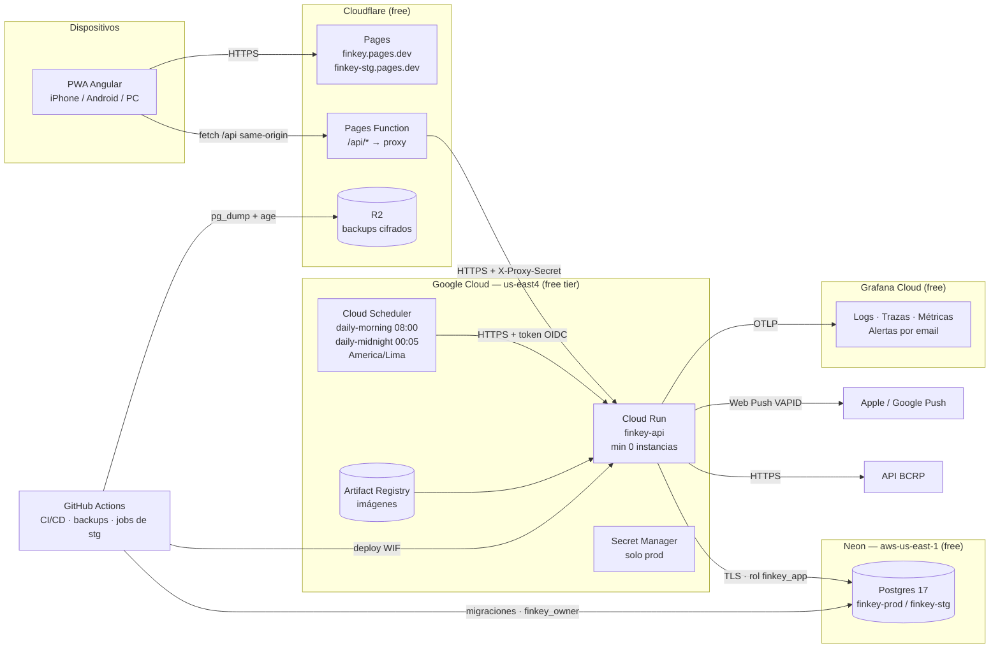
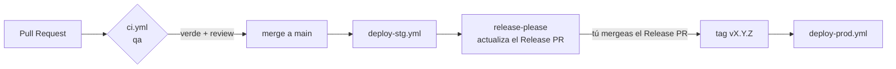

# FinKey — DevOps, despliegue y costos (Fase 7)

Drivers:
- **NFR-04**: $0/mes, alerta en $1.
- **NFR-05**: alertas a las 08:00 ±15 min.
- **NFR-06**: RPO ≤ 24 h.
- **NFR-09**: observabilidad.
- **NFR-01**: seguridad.
- Requisito de visión: encendido y apagado automático sin pérdida de datos.

| Tema | Decisión | ADR |
|---|---|---|
| API | **Google Cloud Run** `us-east4`, *scale-to-zero*, un proyecto GCP por ambiente | [ADR-0017](adr/0017-hosting-cloud-run-cloudflare-neon.md) |
| PWA + proxy | **Cloudflare Pages** + Pages Function `/api/*` | ADR-0015, ADR-0017 |
| Base de datos | **Neon** `aws-us-east-1`, un proyecto por ambiente | ADR-0009, ADR-0017 |
| Scheduler | **Cloud Scheduler** con OIDC en prod; GitHub Actions `schedule` en stg | ADR-0017 |
| Backups | `pg_dump` diario cifrado con **age** → **Cloudflare R2**; prueba de restauración mensual automática | [ADR-0018](adr/0018-backups-cifrados-en-r2.md) |
| Versionado y releases | **release-please** (Release PR = aprobación para prod) | [ADR-0019](adr/0019-releases-con-release-please.md) |
| Observabilidad | **OpenTelemetry → Grafana Cloud** (free); Cloud Logging como respaldo | [ADR-0020](adr/0020-observabilidad-grafana-cloud.md) |
| Email | **No en el MVP** (passkeys + códigos de recuperación; las alertas de Grafana usan su propio email) | — |

---

## 1. Diagrama de despliegue


---

## 2. Encendido y apagado automático (requisito de la visión)
No se necesita un horario de apagado: **todo se apaga solo cuando no se usa y se enciende solo con la primera petición**, sin perder datos, porque el estado vive en Neon.

| Pieza | Se apaga | Se enciende | Datos |
|---|---|---|---|
| Cloud Run | ~15 min sin peticiones → 0 instancias (no cobra CPU) | Con la primera petición: arranque en frío de ~1–3 s (§10.3 de arquitectura) | Sin estado (llaves de Data Protection en Postgres) |
| Neon | 5 min sin consultas → compute suspendido | Con la primera conexión: < 1 s | El storage persiste siempre |
| Cloudflare Pages | No aplica (estático en el CDN) | — | — |
| Jobs | El scheduler despierta la API a las 08:00 y 00:05 y, al terminar, vuelve a apagarse | — | Idempotentes, con *catch-up* (ADR-0007) |

**Anti-patrón explícito:** no se usa ningún *uptime pinger* cada pocos minutos, porque mantendría todo encendido y consumiría el free tier. La salud se vigila con el *heartbeat* de los jobs (§6).

---

## 3. Repositorio y ramas
```
finkey/                           # monorepo público en GitHub
├── src/
│   ├── backend/                  # FinKey.sln: Host, Modules/*, Shared/*, Migrator
│   └── frontend/                 # Angular 22 PWA
│       └── functions/api/[[path]].ts   # Pages Function: proxy /api/* → Cloud Run
├── tests/                        # Unit, Architecture, Integration, E2E (Playwright)
├── infra/
│   ├── gcp/bootstrap.sh          # Script idempotente: proyectos, WIF, Artifact Registry, Scheduler, presupuesto
│   ├── cloudflare/               # _headers, _redirects, config de Pages
│   └── docker/compose.yml        # Local: postgres, api, pwa, grafana/otel-lgtm
├── docs/
├── .github/workflows/
└── release-please-config.json
```
- **Trunk-based**: `main` siempre desplegable; ramas cortas (< 2 días) con la clave de Jira: `FK-23`.
- PR con **rebase-merge** para conservar los commits atómicos; cada commit es un Conventional Commit con la clave al final, p. ej. `feat(ledger): add shared expense split FK-23` (lo valida commitlint); al incluir `FK-23`, el commit se enlaza en Jira (GitHub for Jira).
- Infraestructura como código: en el MVP, **script `bootstrap.sh` idempotente + documentación**. OpenTofu (GCP + Cloudflare) queda como mejora de aprendizaje post-MVP.

---

## 4. Ambientes (detalle de ADR-0009)
| | dev | qa | stg | prod |
|---|---|---|---|---|
| Dónde | Tu PC (Docker Compose) | Runners de GitHub Actions | GCP `finkey-stg` + Cloudflare `finkey-stg` + Neon `finkey-stg` | GCP `finkey-prod` + Cloudflare `finkey` + Neon `finkey-prod` |
| BD | Postgres 17 en Docker (seed de desarrollo) | Testcontainers efímero | Neon, **sin seed** (solo datos ingresados a mano) | Neon, datos reales |
| Despliegue | `docker compose up` / `dotnet watch` + `ng serve` | Cada PR | Automático en cada merge a `main` | Al mergear el Release PR |
| Versión | `0.0.0-dev` | `sha` | `vX.Y.Z-rc.N` | `vX.Y.Z` |
| Cloud Run | — | — | max 1 instancia | max 2 instancias |
| Jobs | Manual (`POST /jobs/...` con el token de dev) | En los tests | GitHub Actions `schedule` (± minutos de demora, aceptable) | Cloud Scheduler (zona America/Lima, OIDC) |
| Secretos | `dotnet user-secrets` | Generados en el job | GitHub Environment `stg` → variables de entorno de Cloud Run | GitHub Environment `production` + **Secret Manager** |
| Observabilidad | grafana/otel-lgtm local | Logs de CI | Grafana Cloud (`env=stg`) | Grafana Cloud (`env=prod`) |

Configuración de Cloud Run (ambos ambientes):
- 1 vCPU, 512 MiB, CPU solo durante las peticiones (facturación por request).
- Concurrencia 40, timeout 60 s, `min-instances=0`.
- Imagen **chiseled** de .NET con ReadyToRun e `InvariantGlobalization=false`, porque se necesita la cultura es-PE.

---

## 5. Pipeline CI/CD (GitHub Actions)


### 5.1 `ci.yml` (en cada PR = ambiente qa)
Corre en paralelo:
1. **Backend**:
   - restore, CSharpier check y build con `TreatWarningsAsErrors`;
   - tests unitarios y de arquitectura;
   - integración con Testcontainers (incluye RLS y la matriz de autorización);
   - cobertura → SonarCloud.
2. **Frontend**:
   - `pnpm install --frozen-lockfile`, Prettier, ESLint;
   - Vitest con cobertura;
   - `ng build` con budgets;
   - verificación del cliente generado desde el OpenAPI (snapshot con Verify).
3. **E2E**:
   - `docker compose` (API + PWA + Postgres);
   - Playwright Chromium + WebKit (móvil/escritorio) + axe;
   - Lighthouse CI.
4. **Seguridad**: CodeQL, `dependency-review-action`, gitleaks, build de la imagen + Trivy.
5. **Commits**: commitlint sobre los commits del PR.

### 5.2 `deploy-stg.yml` (push a `main`)
1. Build de la imagen **una sola vez** → push a Artifact Registry con el tag `sha-<commit>`.
2. Se calcula la versión `vX.Y.Z-rc.N`, donde `X.Y.Z` es la propuesta en el Release PR y `N` el número de ejecución, y se agrega a la imagen como label y como variable `APP_VERSION`.
3. **Migraciones**: `FinKey.Migrator` (consola que aplica en orden las migraciones de cada `DbContext` y las políticas RLS) con el rol `finkey_owner` sobre Neon stg.
4. `gcloud run deploy` (autenticado con Workload Identity Federation, sin llaves JSON) → nueva revisión.
5. Build de la PWA → `wrangler pages deploy` al proyecto `finkey-stg`.
6. **Smoke**: `/health/ready` reporta la versión esperada + subset E2E de Playwright contra stg con un usuario de prueba creado y borrado por el test (stg no tiene seed).
7. release-please actualiza el **Release PR** (changelog y versión siguiente).

### 5.3 `deploy-prod.yml` (tag `vX.Y.Z` creado al mergear el Release PR)
Usa el GitHub Environment `production`, restringido a tags `v*`.
1. **Punto de restauración**: crea una branch de Neon `pre-vX.Y.Z` desde prod y conserva solo las 3 últimas (límite de 10 branches).
2. Migraciones en prod con `finkey_owner`.
3. Deploy en Cloud Run **del mismo digest** probado en stg (re-tag `vX.Y.Z`; no se recompila).
4. Deploy de la PWA a `finkey`.
5. Smoke: `/health/ready` + verificación de solo lectura (sin crear datos en prod).
6. GitHub Release con las notas de release-please → Jira Release (vía GitHub for Jira).

### 5.4 Otros workflows
| Workflow | Disparo | Qué hace |
|---|---|---|
| `jobs-stg.yml` | `schedule` 13:00 UTC y 05:05 UTC (08:00 y 00:05 Lima) | Llama a `/jobs/daily-morning` y `/jobs/daily-midnight` de stg con el token |
| `backup.yml` | `schedule` 08:00 UTC (03:00 Lima) diario | `pg_dump` prod (y stg) → `age` → R2 (ADR-0018) |
| `restore-test.yml` | Primer día de cada mes + manual | Descarga el último backup, lo descifra, lo restaura en un Postgres efímero y valida conteos y la integridad del ledger (Σ asientos por transacción) |
| `codeql.yml` | PR + semanal | Análisis SAST completo |
| Dependabot | Semanal | NuGet, npm, GitHub Actions y Docker base image |

### 5.5 Migraciones y rollback
- **Expand/contract**: toda migración es compatible con la versión anterior del código. Ejemplo: agregar una columna nullable → desplegar → migrar los datos → hacerla obligatoria en el release siguiente.
- **Rollback del código**: `gcloud run services update-traffic --to-revisions=<anterior>=100`, en segundos.
- **Rollback de datos**: restaurar desde la branch de Neon `pre-vX.Y.Z` (dentro de la ventana de 6 h) o desde el backup de R2.
- Nunca hay cambios manuales en la BD de prod.

---

## 6. Observabilidad (ADR-0020)
| Señal | Cómo | Dónde |
|---|---|---|
| Logs | `ILogger` JSON con `trace_id`, `user_id` (nunca datos sensibles, §4 de calidad) | Grafana Cloud Loki (vía OTLP) + Cloud Logging como respaldo (stdout) |
| Trazas | OpenTelemetry: ASP.NET Core, HttpClient, Npgsql, handlers propios (decorador) | Grafana Cloud Tempo |
| Métricas | Runtime de .NET, HTTP, más métricas de negocio: `finkey_job_runs_total{job,status}`, `finkey_push_sent_total{status}`, `finkey_db_size_bytes` | Grafana Cloud (Prometheus/Mimir) |
| Errores del frontend | Grafana Faro (Frontend Observability, free) | Grafana Cloud (se agrega su endpoint al `connect-src` de la CSP) |
| Health | `/health/live`, `/health/ready` (BD + versión) | Cloud Run startup probe + smoke tests |

**Exportación con *scale-to-zero*:** Cloud Run envía SIGTERM antes de apagar; se fuerza el `ForceFlush` de OpenTelemetry en el `ApplicationStopping` (≤ 5 s).

**Alertas** (Grafana Alerting → tu email; gratis):

| Alerta | Condición |
|---|---|
| Errores 5xx | > 2 % de las peticiones en 15 min, o cualquier 5xx en `/jobs/*` |
| Job no ejecutado (*heartbeat*) | Sin `finkey_job_runs_total{status="ok"}` de `daily-morning` en 26 h (también cubre que el scheduler falle) |
| Push fallidos | > 3 fallos en un día (suscripción expirada o VAPID mal configurado) |
| Latencia | p95 > 500 ms sostenido 30 min (excluye los arranques en frío) |
| Storage de BD | `finkey_db_size_bytes` > 400 MB (80 % del free tier de Neon) |
| Backup | El workflow `backup.yml` o `restore-test.yml` falla → notificación de GitHub |

---

## 7. Secretos (repo público)
| Secreto | stg | prod |
|---|---|---|
| Connection string `finkey_app` (runtime) | GitHub Env → variable de Cloud Run | Secret Manager |
| Connection string `finkey_owner` (migraciones) | GitHub Env (solo el pipeline) | GitHub Env (solo el pipeline) |
| Llaves VAPID (pública/privada) | GitHub Env → variable de Cloud Run | Secret Manager |
| `X-Proxy-Secret` | Cloudflare (secret de Pages) + Cloud Run | Cloudflare + Secret Manager |
| Llave de protección de Data Protection | GitHub Env → variable de Cloud Run | Secret Manager |
| Clave pública `age` (backups) | Variable (es pública) | Variable |
| Clave privada `age` | **Fuera de la nube**: en tu gestor de contraseñas + copia offline | ídem |
| Token OTLP de Grafana | GitHub Env | Secret Manager |

- Secret Manager: ~5 secretos en prod, dentro de las 6 versiones activas gratis.
- stg usa variables de entorno de Cloud Run para quedarse en $0. Solo tú tienes acceso al proyecto.
- GitHub → GCP: **Workload Identity Federation** (OIDC de GitHub), sin llaves de cuenta de servicio.
- Cloud Scheduler → API: **token OIDC** de una cuenta de servicio dedicada; la API valida la audiencia y el emisor (Google). En stg, token Bearer aleatorio.

---

## 8. Costos estimados (verificado en octubre de 2026; los free tiers cambian)
| Componente | Free tier | Uso estimado de FinKey | Costo |
|---|---|---|---|
| Cloud Run (por billing account) | 180k vCPU-s, 360k GiB-s, 2M requests/mes | ~500 req/día × ~0,3 s ≈ 5k vCPU-s/mes por ambiente (< 5 %) | $0 |
| Artifact Registry | 0,5 GB | Imagen chiseled ~120 MB; política de limpieza: últimas 3 por ambiente | $0 |
| Cloud Scheduler | 3 jobs por billing account | 2 jobs (prod) | $0 |
| Secret Manager | 6 versiones activas, 10k accesos | ~5 versiones (prod) | $0 |
| Neon | Por proyecto: 0,5 GB, 100 CU-h/mes, restore de 6 h, 10 branches | ~50 MB a 3 años; pocas CU-h por *scale-to-zero* | $0 |
| Cloudflare Pages + Functions | Estáticos ilimitados; Functions = 100k req/día de Workers | ~500 req/día | $0 |
| Cloudflare R2 | 10 GB, 1M operaciones de clase A y 10M de clase B al mes | Dumps comprimidos < 5 MB × ~45 retenidos | $0 |
| Grafana Cloud | 10k series, 50 GB de logs/trazas, retención de 14 días | < 1 GB | $0 |
| GitHub (repo público) | Actions ilimitado, GHAS (CodeQL, secret scanning) | — | $0 |
| Dominio | — | No se compra (subdominios gratuitos) | $0 |
| **Total** | | | **$0/mes** |

**Protecciones de costo**
- **Presupuesto de GCP de $1** en la billing account, con alertas por email al 50 %, 90 % y 100 %.
  - Las alertas no frenan el gasto. El tope real lo dan `max-instances`, el rate limiting y los límites anteriores.
  - Opcional: un *kill switch* (presupuesto → Pub/Sub → función que deshabilita el billing). Queda fuera del MVP por su riesgo de apagar prod.
- **R2 pide una tarjeta registrada** aunque sea gratis; se configura una notificación de uso en Cloudflare.
- **Al superar los límites, Neon y Workers fallan** (suspenden o devuelven un error) en vez de cobrar. Por eso existe la alerta de storage al 80 %.
- **Cada trimestre se revisa la factura y los free tiers** (tarea recurrente en Jira).

---

## 9. Desarrollo local
- `docker compose -f infra/docker/compose.yml up`: Postgres 17, API (hot reload con `dotnet watch`), PWA (`ng serve` con `proxy.conf.json` para `/api`, el mismo modelo que en producción) y `grafana/otel-lgtm` (observabilidad local en `localhost:3000`).
- Seed de desarrollo con Bogus (solo dev; nunca en stg ni en prod).
- Web Push local: llaves VAPID de dev; se prueba en Chrome de escritorio y en el iPhone por el túnel `cloudflared` (HTTPS).

---

## 10. Checklist de puesta en marcha (Sprint 0 / 1)
- [ ] Crear el repo público `finkey`, proteger `main` y activar secret scanning + push protection, Dependabot y CodeQL.
- [ ] Crear los proyectos de GCP `finkey-stg` y `finkey-prod`, con la billing account y el presupuesto de $1.
- [ ] Ejecutar `infra/gcp/bootstrap.sh`: APIs, Artifact Registry + limpieza, WIF, cuentas de servicio y Cloud Scheduler (prod).
- [ ] Crear los proyectos de Neon `finkey-stg` y `finkey-prod` (`aws-us-east-1`, Postgres 17) con los roles `finkey_owner` y `finkey_app`.
- [ ] Crear los proyectos de Cloudflare Pages `finkey-stg` y `finkey` y el bucket de R2 `finkey-backups`, con el token de API limitado.
- [ ] Crear el stack de Grafana Cloud y el token OTLP.
- [ ] Generar las llaves VAPID y el par `age` por ambiente; guardar la privada en el gestor de contraseñas.
- [ ] Configurar los GitHub Environments `stg` y `production` y sus secretos.
- [ ] Primer despliegue de un "hello world" con `/health` en stg y prod (*walking skeleton*).
